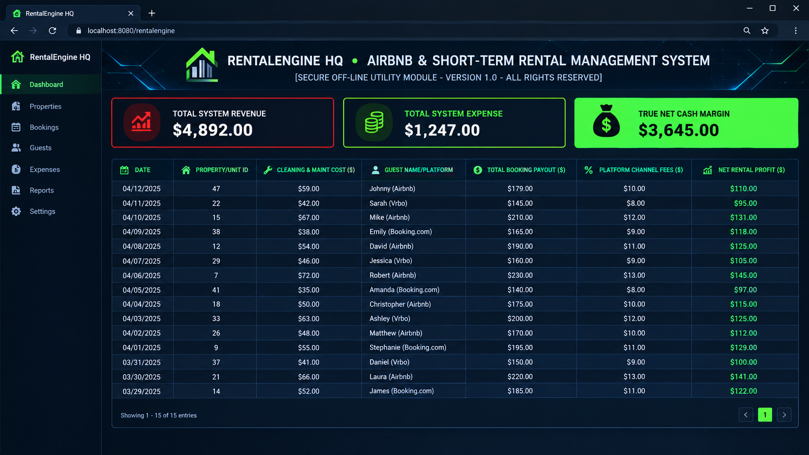

# Short-Term Rental Portfolio Management System & Cash Flow OS

Corporate Operations Back-Office Dashboard & Standalone Property Engine

  

### 🔑 SECURE ENTERPRISE PROCURE CONDUIT
Bypass bloated monthly software licensing fees instantly. Secure your permanent, offline dark-mode corporate Excel operating workbook below:

### [👉 PROCURE THE EXCEL OPERATION ENGINE NOW ($149.00)](https://rentalengine.gumroad.com)

*⚡ One-Time Corporate License. Permanent Local Ownership. Instant Vault Delivery.*

---

Welcome to the off-grid documentation node for the specialized Back-Office Operating System framework—a break-proof property ledger engineered exclusively for elite Microsoft Excel (.xlsx) local deployments. Designed explicitly to lower monthly business property management software overhead, this standalone layout handles short-term occupancy metrics, real-time booking revenue allocation, cleaning/operational cost burn, and true net cash flow profit calculations natively on background formula automation.

🔒 **100% Corporate Vault-Secured:** This industrial spreadsheet utility is completely Macro-Free, formula-locked, and cleared of tracking scripts to instantly satisfy strict company data firewalls.
